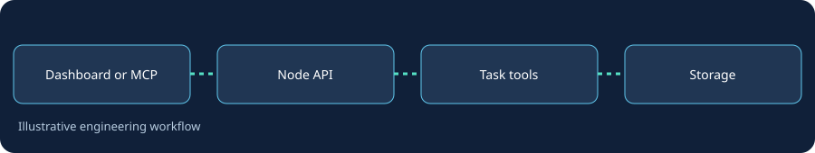
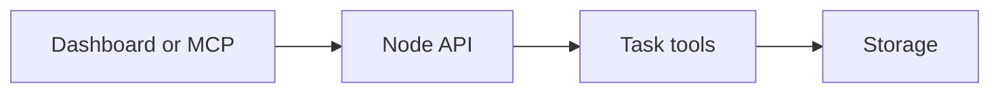
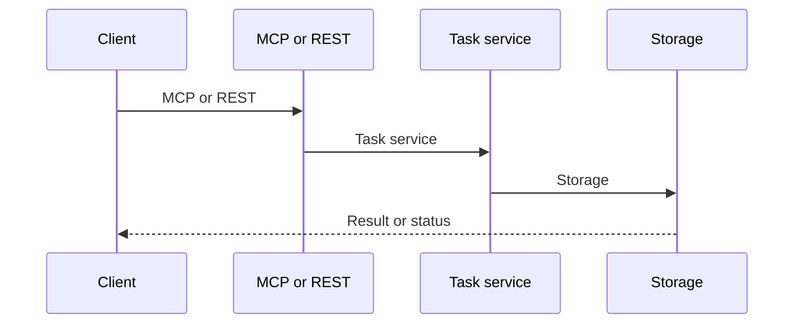

# Echo Assist

<!-- portfolio-visual-start -->
## Engineering overview

 





Illustrative workflow: Dashboard or MCP → Node API → Task tools → Storage. See the implementation and setup below for actual capabilities and prerequisites.

[Developer profile](https://github.com/ABHILASH9519) · [Issues](https://github.com/ABHILASH9519/echo-assist/issues)
<!-- portfolio-visual-end -->


Echo Assist is a productivity command center with a task dashboard, REST API, MCP task tools, and optional Amazon Bedrock responses.

## Features

- Create, search, list, complete, and delete tasks.
- Set task priority (low, medium, high) and optional due dates.
- Daily agenda endpoint shows tasks due today and overdue tasks.
- Natural-language task commands: `add prepare demo`, `list my tasks`, `complete prepare demo`, and `agenda today`.
- Add task metadata in a command, e.g. `add prepare demo priority high due 2026-10-30`.
- MCP Streamable HTTP endpoint at `POST /mcp` with `add_task`, `list_tasks`, and `complete_task` tools.
- Optional PostgreSQL persistence when `DATABASE_URL` is configured; JSON-file fallback for local prototyping.
- Optional Amazon Bedrock Converse API for open-ended assistant responses. The UI reports whether Bedrock is configured.

## Run locally

Requires Node.js 22 or later.

```bash
npm install
cp .env.example .env
npm start
```

On Windows PowerShell, use `Copy-Item .env.example .env` instead of `cp`. Open http://localhost:3000.

## Storage

For durable storage, provision a PostgreSQL database and set `DATABASE_URL` in the app's runtime environment. The server creates the `echo_tasks` table on startup. For a TLS-enabled provider, leave `PGSSL` unset. Set `PGSSL=disable` only for local PostgreSQL without TLS.

Without `DATABASE_URL`, tasks are stored in `.data/tasks.json` (or the directory set by `DATA_DIR`). That file is not durable on an ephemeral hosting filesystem.

## Amazon Bedrock (optional)

1. Ensure your AWS account has access to a supported Bedrock model in your chosen region.
2. Set `AWS_REGION` and `BEDROCK_MODEL_ID` in the runtime environment.
3. Configure AWS credentials using an IAM role or your host's secret manager. Never commit credentials.
4. Verify `GET /api/health` reports `aiConfigured: true`, then send an open-ended assistant request and verify the response.

Task-management commands are handled by the application itself and report `mode: local`. Open-ended responses use Bedrock only when the model ID and valid AWS credentials are available, and report `mode: bedrock`. A configured model ID alone does not guarantee that model access works.

## API

- `GET /api/health` — app status, storage mode, Bedrock configuration status.
- `GET /api/tasks`
- `POST /api/tasks` with `{"title":"Prepare demo","priority":"high","dueDate":"2026-10-30"}`
- `PATCH /api/tasks/:id` — update title, details, priority, or due date.
- `PATCH /api/tasks/:id/complete`
- `DELETE /api/tasks/:id`
- `GET /api/agenda?date=2026-10-30`
- `POST /api/assistant` with `{"message":"Add prepare demo priority high due 2026-10-30"}`

## MCP

The server exposes a stateless Streamable HTTP MCP endpoint at `/mcp`. Use an MCP client that supports Streamable HTTP and point it to your deployed base URL plus `/mcp`. Verify with a real MCP inspector/client before describing this integration as tested.

## Deployment notes

The app listens on `0.0.0.0` and uses `PORT`. Set `DATABASE_URL` to a managed database for durable production storage. Some serverless or ephemeral filesystems reset data on restart/redeploy.

## Security and limitations

This is a hackathon MVP, not a multi-user production service. It has no authentication or per-user task isolation. Do not store sensitive personal data. Configure Bedrock and database access through IAM/host secrets. Before production, add authentication, user-scoped data access, request rate limiting, structured logging, and end-to-end tests.

## Hackathon submission checklist

- [ ] Test task CRUD and priority/due-date behavior in the deployed app.
- [ ] Verify the MCP endpoint with a real MCP client.
- [ ] Configure and verify a real Bedrock response before claiming the integration is active.
- [ ] Verify PostgreSQL is active in `/api/health` before claiming durable database storage is live.
- [ ] Record a public English demo video under the event's time limit.
- [ ] Keep the Devpost description aligned with verified features.


## Technical walkthrough



This sequence is a conceptual review aid, not a recorded execution trace. Consult the implementation and existing run instructions for supported behavior.

 

**Review focus:** task-management API and MCP integration, with optional Amazon Bedrock support. No Amazon endorsement or production deployment is implied.
